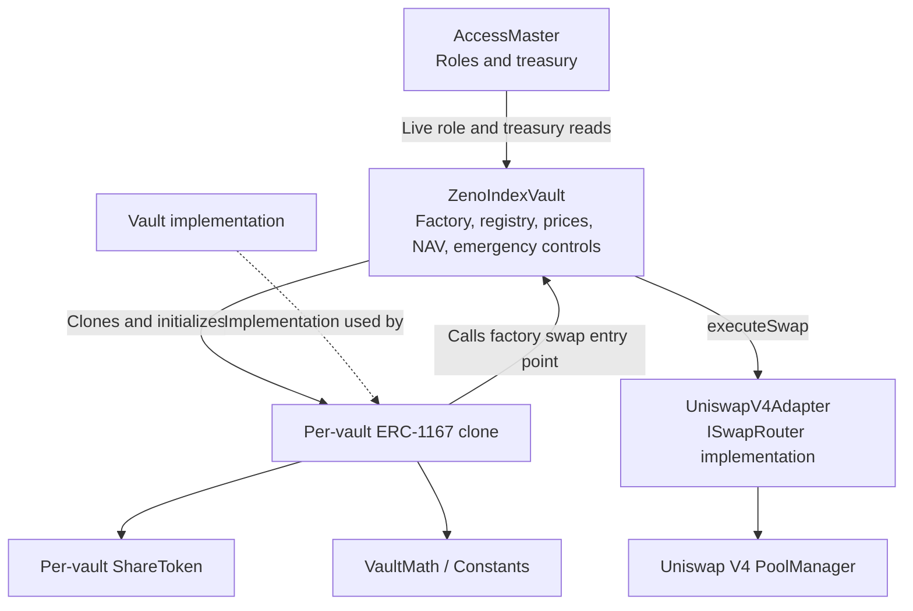

# ZenoIndex EVM

ZenoIndex is an EVM smart-contract system for creating and operating index-style vaults. Authorized creators launch vaults, investors deposit the configured stablecoin and receive vault shares, and vault managers manage allocations, swaps, rebalancing, and redemptions.

This repository contains the on-chain contracts and Foundry scripts. It is one part of the wider Zeno product: the mobile app and hosted Zeno backend are separate projects and integrate with these contracts through their own interfaces and API layers.

> [!IMPORTANT]
> **Passing tests or a fork simulation does not mean mainnet is production-ready.** The current Uniswap V4 adapter scripts assume a USDG/NVDA pool configuration. Verify the actual pool key, initialization, hooks, liquidity, prices, addresses, signer, and chain before broadcasting transactions. Never use unverified configuration with real funds.

## Contents

- [Project overview](#project-overview)
- [Features](#features)
- [Architecture](#architecture)
- [Contract reference](#contract-reference)
- [Protocol lifecycle](#protocol-lifecycle)
- [Roles and permissions](#roles-and-permissions)
- [Assets, pricing, and swaps](#assets-pricing-and-swaps)
- [Redemptions and recovery](#redemptions-and-recovery)
- [Repository structure](#repository-structure)
- [Requirements](#requirements)
- [Clone and build](#clone-and-build)
- [Testing and development commands](#testing-and-development-commands)
- [Environment configuration](#environment-configuration)
- [Network details](#network-details)
- [Deployment guide](#deployment-guide)
- [Post-deployment verification](#post-deployment-verification)
- [Security and operational requirements](#security-and-operational-requirements)
- [Troubleshooting](#troubleshooting)
- [Related documentation](#related-documentation)

## Project overview

ZenoIndex provides on-chain infrastructure for index-style investment vaults:

1. An authorized account creates a vault with registered assets and target allocations.
2. The vault creates a share token. Investors deposit the configured stablecoin and receive shares based on the vault's calculated net asset value (NAV), subject to fee and share-supply rules.
3. A vault manager can buy assets and rebalance holdings through the configured swap router.
4. Investors can request redemption and claim proceeds after required swap legs are completed. Supported in-kind exit and recovery paths exist when a normal swap-based exit is not suitable or available.

Main components:

- **`ZenoIndexVault`**: factory, asset registry, price table, NAV valuation, swap entry point, emergency controls, and administrative relays.
- **`Vault`**: implementation used by each vault clone; manages shares, deposits, redemptions, allocations, and rebalancing.
- **`AccessMaster`**: shared source of truth for the super-admin, global operators, and treasury.
- **`UniswapV4Adapter`**: implements the swap-router interface and routes swaps through a Uniswap V4 `PoolManager`.
- **`VaultMath` and `Constants`**: financial calculations and protocol bounds.

## Features

- ERC-1167 minimal-proxy vault clones created by a factory.
- One six-decimal share token per vault.
- Configurable stablecoin for deposits and accounting. The contract variable is named `usdcToken`; the configured token can be USDC or USDG for a given factory instance.
- Admin-maintained token prices with stale-price and price-movement checks.
- Uniswap V4 exact-input, multi-hop swap adapter with explicitly registered pool keys and authorized callers.
- Deposit and redemption fees, share calculations, and share-cap handling.
- Target allocations and portfolio rebalancing.
- Swap-based redemption, in-kind exits, and timeout-based redemption settlement.
- Emergency, pause, and vault-lock controls.
- Write-off, reactivation, and written-off-token sweep flows.
- Foundry unit and regression tests.

## Architecture



## Contract reference

### `ZenoIndexVault.sol`

**What it does:** Acts as the vault factory and central registry. It creates vault clones, tracks registered assets and prices, calculates NAV, routes swaps, and provides administrative and emergency controls.

Key dependencies and execution path:

- `Clones.clone` creates an ERC-1167 clone of the vault implementation.
- `IVault(clone).init` initializes the newly created vault.
- `Constants.MAX_ASSETS` defines the asset-count bound.
- `ISwapRouter(router).swap` forwards approved swap requests to the configured router.

| Function | Purpose |
|---|---|
| `createVault` | Creates and initializes a vault clone. |
| `executeSwap` | Validates and forwards swaps from registered vaults. |
| `sumNav` | Calculates the portfolio's net asset value. |
| `setSwapRouter` | Configures the swap router. |
| `setPrice` / `setPriceWhole` | Updates asset prices. |
| `setVaultCreator` | Controls which accounts may create vaults. |
| `superAdmin` | Reads the super-admin from `AccessMaster`. |

Refer to the source for exact signatures, access modifiers, validation rules, and revert conditions.

### `Vault.sol`

**What it does:** Implements the lifecycle of an individual index vault, including deposits, share issuance, redemptions, claims, swaps, allocation management, and recovery flows.

Key dependencies and execution path:

- `VaultMath.computeSharesToMint` calculates shares for a deposit.
- `ShareToken.mint` issues vault shares.
- `ZenoIndexVault.sumNav` obtains the vault's NAV.
- `IZenoIndexVault.executeSwap` routes swaps through the factory.
- `ReentrancyGuard` protects applicable state-changing operations against reentrancy.

| Function | Purpose |
|---|---|
| `init` | Initializes the vault clone. |
| `genesisDeposit` | Handles the initial manager deposit. |
| `deposit` | Accepts a stablecoin deposit and issues shares. |
| `previewDeposit` | Quotes the shares expected from a deposit. |
| `requestRedeem` | Starts a redemption and burns shares. |
| `claim` | Claims stablecoin proceeds for a redemption. |
| `claimInKind` | Settles a redemption by transferring the underlying assets. |
| `executeRebalance` | Rebalances the portfolio toward its target allocations. |
| `swapUsdcToAsset` | Swaps the configured stablecoin for an asset. |
| `forceSettleRedeem` | Executes the supported timeout-based redemption settlement. |

Function names and availability should be checked against the current source before integrating with the contract.

### `AccessMaster.sol`

**What it does:** Centralizes privileged roles and treasury configuration used by the factory and vault system.

Key dependencies:

- OpenZeppelin `AccessControl` provides role-based access control.
- `setSuperAdmin` uses the contract's two-step super-admin transfer flow.
- `addOperator` grants the supported global operator role.
- `removeOperator` revokes the supported global operator role.
- `OPERATOR_ROLE` identifies the global operator permission.

| Function | Purpose |
|---|---|
| `superAdmin` | Reads the current super-admin. |
| `setSuperAdmin` | Proposes a super-admin transfer. |
| `acceptSuperAdmin` | Completes the proposed transfer. |
| `addOperator` | Adds an authorized global operator. |
| `removeOperator` | Removes a global operator. |
| `setTreasury` | Updates the treasury address. |

The source contract defines the exact role checks and validation requirements.

### `VaultMath.sol`

**What it does:** Contains shared calculations used by the vault system for share issuance, fees, redemption amounts, and allocation calculations.

Key dependencies:

- `Constants.BPS_DENOM` defines the basis-point denominator used in fee and percentage calculations.
- `Constants.PRICE_SCALE` defines the scale used by price-related calculations.

| Function | Purpose |
|---|---|
| `computeSharesToMint` | Calculates shares to mint for a deposit. |
| `computeDepositFee` | Calculates the deposit fee. |
| `computeRedeemAmounts` | Calculates redemption amounts. |
| `computeAllocationSlice` | Calculates the amount associated with an allocation. |

Check the library source for exact rounding behavior, bounds, and revert conditions.

### `UniswapV4Adapter.sol`

**What it does:** Implements the project's swap-router interface and executes swaps through the configured Uniswap V4 `PoolManager` using registered pool configurations.

Key dependencies:

- `IPoolManager` provides the Uniswap V4 pool-manager interface.
- `poolManager.unlock` starts the unlock/callback flow used by the adapter.
- `poolManager.swap` executes a swap against the selected pool.
- `TickMath` supports tick and price-limit calculations.

| Function | Purpose |
|---|---|
| `setAuthorizedCaller` | Authorizes or removes an account permitted to call the adapter. |
| `setPool` | Registers the pool configuration for a token pair. |
| `swap` | Executes a supported exact-input swap. |
| `unlockCallback` | Handles the PoolManager unlock callback. |

Pool registration alone does not establish that a pool is initialized or has usable liquidity. Verify the full pool key and live pool state before production use.

### Interfaces and mocks

The following files define interfaces or test helpers:

| File | Purpose |
|---|---|
| `IAccessMaster.sol` | Interface for shared role and treasury information. |
| `ISwapRouter.sol` | Interface used to execute swaps through a router. |
| `IVault.sol` | Interface for vault initialization and factory-to-vault calls. |
| `IZenoIndexVault.sol` | Interface for vault-to-factory operations such as NAV and swap execution. |
| `MockERC20.sol` | Test ERC-20 token used in unit tests. |
| `MockSwapRouter.sol` | Mock router used to test vault swap behavior without relying on a live pool. |
| `Constants.sol` | Protocol constants and bounds. |
| `ERC20Minimal.sol` | Minimal ERC-20 base used by the project. |
| `ShareToken.sol` | Vault-owned six-decimal ERC-20 share token. |

Mocks are testing utilities, not production contracts.

### `FeeEscrow.sol`

**What it does:** Holds and accounts for accrued platform and vault-manager fees across vault clones.

Key behaviors:

- Only registered vault clones can account for fees.
- The vault transfers fee tokens to the escrow and supplies the fee split calculated by `VaultMath`.
- The current fee split allocates 20% of the fee amount to the platform and 80% to the vault manager.
- Managers claim their accumulated fees using `claimManagerFees`.
- The configured treasury claims platform fees using `claimPlatformFees`.
- `totalClaimable` tracks accrued liabilities by token, and accounting checks that the escrow balance covers those liabilities.
- `FeeType` defines Deposit, Redemption, and Trading categories. Trading-fee collection is not yet integrated into the vault flow.

## Protocol lifecycle

### 1. Deploy and configure

The core deployment script deploys the `Vault` implementation, `AccessMaster`, `ZenoIndexVault`, and a `FeeEscrow` linked to that factory, then registers the escrow through `setFeeEscrow`. The swap adapter and router configuration are separate steps. Before creating a vault, the factory needs a router and each non-stablecoin asset used by the basket needs a configured price.

### 2. Create a vault

The super-admin or an account allowlisted with `setVaultCreator` calls `ZenoIndexVault.createVault`. The factory clones the `Vault` implementation and initializes the clone. Initialization defines the manager, fee recipient, asset IDs, and target allocation basis points, subject to contract validation.

### 3. Seed the vault

The vault manager calls `genesisDeposit` to seed the vault according to the genesis rules. This is separate from normal investor deposits.

### 4. Deposit and issue shares

An investor calls `deposit` with the configured stablecoin. The vault calculates NAV and shares to mint, applies the configured fee and share-cap rules, receives the deposit, pays fees, mints shares, and records pending allocation targets. `previewDeposit` uses the shared quote logic so its result follows the deposit calculation.

### 5. Buy assets and rebalance

The vault manager can call `swapUsdcToAsset` and `executeRebalance`. The vault calls `ZenoIndexVault.executeSwap`; the factory restricts this entry point to registered vault clones and enforces a minimum output based on the configured price table and slippage setting. The factory then calls the configured `ISwapRouter`.

For Uniswap V4, the adapter uses explicitly registered pool keys. Registering a token in the factory does **not** mean that a usable swap route exists. Each required pool must have the correct currency ordering, fee, tick spacing, hook address, initialization state, and usable liquidity.

### 6. Redeem and claim

An investor calls `requestRedeem`, which burns shares and accounts for the corresponding redemption legs. Asset legs may need to be swapped to the stablecoin before `claim` can pay proceeds. The vault also supports `claimInKind` and a timeout-based `forceSettleRedeem` path. Exact permissions, timing, and pause/emergency behavior are enforced by the contracts.

### 7. Operate and recover

Managers can change target allocations and rebalance. The code includes proposal/confirmation flows for writing off and reactivating assets, and a super-admin sweep path for written-off balances. Emergency and pause controls restrict specified operations while supported exit/recovery paths remain available.

## Roles and permissions

| Role | What it can do |
|---|---|
| **Super-admin** | Controls factory configuration, prices and safety parameters, asset activation, creator allowlisting, per-vault operator permissions, emergency controls, and administrative recovery actions. The source of truth is `AccessMaster`. |
| **Global operator** | Has operator-level access to supported asset-registry operations. This role does not automatically grant manager permissions on every vault. |
| **Vault creator** | An account allowlisted by the super-admin to call `createVault`. The super-admin can also create vaults. |
| **Vault manager** | The configured manager, plus any account explicitly authorized for that specific vault through the factory. Can perform manager-gated operations such as swaps, allocation updates, and rebalancing. |
| **Investor** | Deposits the configured stablecoin, receives vault shares, and uses supported redemption and claim/exit paths. |

Super-admin transfer in `AccessMaster` is two-step: the current admin proposes a new address, and the proposed address accepts. The contract prevents inherited OpenZeppelin role-management functions from independently granting or revoking the admin role. Vault operator permissions are scoped per vault.

## Assets, pricing, and swaps

### Stablecoin configuration

The factory's `usdcToken` field is the configured deposit/accounting stablecoin. Despite the variable name, `script/Deploy.s.sol` accepts either USDC or USDG through `STABLECOIN`. A factory instance has one configured stablecoin; this does not mean USDC and USDG are both accepted by the same instance.

The project's mainnet review documents a stablecoin slot in every production vault basket as an operational convention. Confirm the exact asset IDs and allocations for each vault.

### Asset registration versus investment support

For an asset to be usable in a production vault, verify all applicable items:

1. The correct ERC-20 token address is registered in `ZenoIndexVault`.
2. A valid price is configured for each non-stablecoin asset.
3. The adapter has the correct V4 pool key for every required swap hop.
4. Each pool is initialized and has sufficient liquidity for the intended trade.
5. Any nonzero hook address is allowed by the adapter and has been reviewed.
6. The factory's router is configured, and the adapter authorizes the factory as a caller.
7. The expected trade size, price impact, and minimum output are acceptable.

An asset registry entry, a price entry, or an adapter pool registration by itself does not guarantee successful or economically safe swaps. Do not describe an asset as production-supported until the full path has been verified.

### Price table and NAV

`ZenoIndexVault` values the configured stablecoin at 1:1 and values other assets using the admin-maintained price table. Prices are managed through `setPrice` / `setPriceWhole`; check the function implementation and script for the units expected by a particular call.

The code's documented defaults include:

- Maximum price age: **1 day**
- Maximum single price move: **20%**
- Maximum swap slippage setting: **3%**

The super-admin can configure these limits. Missing or stale prices can block operations that depend on NAV. The price table is an administrative input, not an on-chain market oracle, so production requires a trusted and monitored price-update process.

### Swap protections

- The factory's `executeSwap` is restricted to registered vault clones.
- The factory requires `from` to equal the calling vault clone.
- The factory raises the requested minimum output to its price-table-based slippage floor.
- The adapter restricts `swap` to authorized callers.
- The adapter restricts `unlockCallback` to the configured V4 `PoolManager`.
- Pool registration includes the currencies, fee, tick spacing, and hook address.

These checks do not eliminate market, liquidity, pricing, or administrative-key risk. Fee-on-transfer and rebasing tokens are unsupported by the current design.

## Redemptions and recovery

- **`requestRedeem`** burns shares and accounts for the redemption legs. It reverts if all legs round to zero.
- **`claim`** pays the stablecoin proceeds once required swap legs have been completed.
- **`claimInKind`** closes a redemption by paying unswapped legs in the corresponding assets, plus any escrowed stablecoin, subject to token transfer success.
- **`forceSettleRedeem(user)`** provides an in-kind settlement path after the configured timeout, documented in the code as seven days.
- **Rebalancing** trades toward target allocations. A zero-target asset is wound down and its slot may be retired when the required conditions are met; active redemptions can prevent retirement.
- **Write-off/reactivation** uses a manager proposal and super-admin confirmation. The configured stablecoin cannot be written off through the normal asset write-off path.
- **Emergency/pause behavior** is function-specific. Do not assume that every function is disabled or every exit remains possible; inspect the implementation and tests for precise behavior.

## Repository structure

```text
.
├── src/
│   ├── ZenoIndexVault.sol
│   ├── Vault.sol
│   ├── AccessMaster.sol
│   ├── adapters/
│   │   └── UniswapV4Adapter.sol
│   ├── interfaces/
│   ├── libraries/
│   │   ├── Constants.sol
│   │   └── VaultMath.sol
│   ├── mocks/
│   └── tokens/
├── script/
│   ├── Deploy.s.sol
│   ├── DeployUniswapV4Adapter.s.sol
│   ├── ConfigureUniswapV4Adapter.s.sol
│   ├── DeployAndConfigureUniswapV4Adapter.s.sol
│   └── check-readme-src-docs.sh
├── test/
├── docs/
│   └── MAINNET_REVIEW.md
├── .env.example
├── .gitignore
├── .gitmodules
├── foundry.toml
├── LICENSE
└── README.md
```

This tree highlights the main files; inspect the repository for the complete test and dependency layout.

## Requirements

- Git
- [Foundry](https://book.getfoundry.sh/) (`forge`, `cast`, and optionally `anvil`)
- Initialized Git submodules/dependencies
- An RPC endpoint for fork testing or deployment
- A funded account only when sending real transactions

The project pins Solidity `0.8.26`, uses the Cancun EVM target, optimizer, and `via_ir` in `foundry.toml`. Use the repository's compiler settings instead of changing them ad hoc.

## Clone and build

```bash
git clone https://github.com/CyreneAI/zenoindex-evm.git
cd zenoindex-evm

git submodule update --init --recursive
forge build
```

If the repository is already cloned, run commands from its root. If the build fails, check that Foundry is installed and that submodules and remappings are present before changing contract code.

## Testing and development commands

### Run all tests

```bash
forge test --summary
```

A previous run on the reviewed branch reported **221 passing tests, 0 failures, and 0 skipped tests** across `AccessMasterTest`, `AuditPoC`, `UniswapV4AdapterTest`, `VaultMathTest`, and `ZenoIndexVaultTest`. Re-run tests on the current checkout before relying on that number.

### Run a specific test file

```bash
forge test --match-path test/ZenoIndexVault.t.sol -vv
forge test --match-path test/UniswapV4Adapter.t.sol -vv
```

Use the exact file names present in `test/` if they differ in your checkout.

### Run PoC regression tests

```bash
forge test --match-test 'test_PoC' -vv
```

### Run coverage

```bash
forge coverage --ir-minimum --report summary
```

### Check Solidity formatting

```bash
forge fmt --check
```

To apply formatting rather than just check it:

```bash
forge fmt
```

Review the diff after formatting.

### Check documentation coverage

```bash
bash script/check-readme-src-docs.sh
```

### Start a local development chain

```bash
anvil
```

Anvil is a local development chain. It is not Robinhood Chain testnet or mainnet.

**What tests prove:** tests and fork simulations validate the states represented by the test environment. They do not independently prove live pool initialization/liquidity, production price correctness, or readiness for real user deposits.

## Environment configuration

Start with the checked-in example:

```bash
cp .env.example .env
```

The `.env.example` file is the source of truth for variables consumed by the current scripts. The documented variables include:

| Variable | Purpose |
|---|---|
| `PRIVATE_KEY` | Private key for deployment transactions. Keep it secret. |
| `RH_RPC_URL` | RPC endpoint; the example defaults to Robinhood Chain testnet. |
| `STABLECOIN` | Address of the configured USDC or USDG token for `Deploy.s.sol`. |
| `TREASURY` | Optional fee treasury; defaults to the deployer if unset in `Deploy.s.sol`. |
| `ASSET_0` … `ASSET_4` | Optional token addresses to register during core deployment. |
| `ASSET_0_PRICE` … `ASSET_4_PRICE` | Optional prices for the corresponding assets, passed to `setPriceWhole`. |

Price values must use the units expected by `setPriceWhole`; verify those units in the implementation before entering values. Do not copy placeholder addresses or prices into a live deployment.

For Bash or Git Bash, load the environment file with:

```bash
set -a
source .env
set +a
```

Never commit `.env`, paste a private key into chat, or print secrets in logs. Confirm `.gitignore` protects the file before proceeding.

## Network details

The repository's Foundry configuration documents these Robinhood Chain networks:

| Network | Chain ID | RPC URL |
|---|---:|---|
| Robinhood Chain testnet | `46630` | `https://rpc.testnet.chain.robinhood.com` |
| Robinhood Chain mainnet | `4663` | `https://rpc.mainnet.chain.robinhood.com` |

The current `foundry.toml` maps the `robinhood_testnet` and `robinhood` RPC aliases to `RH_RPC_URL`. Set that variable to the intended network endpoint before using either alias. Verify current RPC availability and chain ID before deployment.

## Deployment guide

> [!CAUTION]
> Deployment and configuration transactions change on-chain state. Review every address, chain ID, signer, token, pool parameter, and expected transaction before adding `--broadcast`. A fork simulation is not a mainnet deployment.

### Understand the deployment scripts first

| Script | Purpose | Important limitation |
|---|---|---|
| `script/Deploy.s.sol` | Deploys a new `Vault` implementation, `AccessMaster`, `ZenoIndexVault`, and factory-linked `FeeEscrow`; configures the escrow and optionally registers assets from environment variables. | Does not deploy or configure the Uniswap V4 adapter or set the factory router. |
| `script/DeployUniswapV4Adapter.s.sol` | Deploys an adapter for the addresses and parameters defined in that script. | Inspect its hardcoded addresses and assumptions before use. |
| `script/ConfigureUniswapV4Adapter.s.sol` | Configures an existing adapter using `ADAPTER_ADDRESS`. | Requires an adapter already deployed on the target chain and a factory router that is still unset. |
| `script/DeployAndConfigureUniswapV4Adapter.s.sol` | Deploys the adapter and configures factory authorization, a pool, and the factory router in one script. | Contains hardcoded mainnet addresses and assumed USDG/NVDA pool parameters. It is not a generic testnet script. |

### 1. Prepare the core deployment

Set `PRIVATE_KEY`, `RH_RPC_URL`, and `STABLECOIN` in `.env`. Set `TREASURY` if the treasury should differ from the deployer. Optional `ASSET_n` and `ASSET_n_PRICE` variables can register assets and price them during core deployment.

Before sending transactions, verify:

- The selected chain ID matches the RPC endpoint.
- The stablecoin address is correct for that network.
- The signer is the intended deployer and has sufficient native token for gas.
- Optional asset addresses and price units are correct.
- The intended treasury and admin addresses are secure.

### 2. Simulate core deployment

With the environment loaded, run the script **without** `--broadcast` first:

```bash
forge script script/Deploy.s.sol:Deploy \
  --rpc-url "$RH_RPC_URL" \
  --chain-id 46630 \
  -vvvv
```

This command is an example for testnet. For mainnet, use the verified mainnet RPC and chain ID `4663` only after the production checklist has been completed. Do not add `--broadcast` until you have reviewed the simulation output and explicitly intend to send transactions.

### 3. Broadcast the core deployment only when approved

After successful simulation and review, a testnet broadcast uses:

```bash
forge script script/Deploy.s.sol:Deploy \
  --rpc-url "$RH_RPC_URL" \
  --broadcast \
  --chain-id 46630 \
  -vvvv
```

This is a real transaction when the RPC is testnet. For mainnet, substitute the verified mainnet endpoint and chain ID `4663` only after all production checks are complete. Save emitted contract addresses and transaction hashes in the deployment record.

### 4. Configure the Uniswap V4 adapter

The adapter configuration scripts assume specific factory, PoolManager, USDG, and NVDA addresses. The combined script also assumes fee `100`, tick spacing `1`, and zero hooks for the USDG/NVDA pool.

These are **script parameters, not proof of an existing usable pool**. Before running these scripts against mainnet, verify the actual V4 pool key, currencies, fee, tick spacing, hook address, initialization, liquidity, and intended price impact. If verified pool parameters differ, do not run the script unchanged.

The combined script is intended to deploy the adapter, authorize the factory as a caller, register the assumed pool, and set the factory router. The standalone configuration script requires an adapter that already exists on the target network. Do not run both scripts blindly: they expect the factory router to be unset, and the standalone script will fail if the specified adapter does not exist.

A fresh fork starts from the selected live-chain state; it does not preserve state changes from a separate prior fork simulation. A simulation can predict deployment and configuration behavior, but it does not persist changes to the real chain.

### 5. Complete post-deployment configuration

Before creating a vault:

1. Verify the factory's stablecoin, super-admin, and router addresses.
2. Verify the adapter's `PoolManager`, admin, authorized callers, and registered pool keys.
3. Verify every required pool is initialized and has sufficient liquidity.
4. Register the intended asset addresses and activate them as needed.
5. Set and verify prices for every non-stablecoin asset.
6. Establish a price keeper/monitoring process. The documented default maximum price age is one day.
7. Allowlist only intended vault creators.
8. Configure vault managers and per-vault operator permissions deliberately.
9. Follow the project's documented stablecoin-slot convention for each production vault.
10. Test genesis, deposit, swap, rebalance, redeem, in-kind exit, and recovery paths in an appropriate non-production environment.

If the core deployment initially uses a hot EOA as super-admin, the mainnet review recommends transferring admin control to a secure multisig before accepting user deposits. Use the two-step `setSuperAdmin` / `acceptSuperAdmin` flow.

## Post-deployment verification

Do not rely only on console output. Independently read state from deployed contracts and verify:

- The factory is deployed at the recorded address on the expected chain.
- `superAdmin()`, `treasury()`, `usdcToken()`, and `router()` match the deployment record.
- The router points to the intended adapter.
- The adapter uses the expected Uniswap V4 `PoolManager`.
- The factory is an authorized adapter caller.
- Every registered pool key matches the verified live pool configuration.
- Every required pool is initialized and has enough liquidity for expected trade sizes.
- Asset prices are present, use the intended units, and are fresh.
- Creator and manager permissions are correct.
- Controlled end-to-end tests succeed in the intended test environment.

Keep transaction hashes, block numbers, addresses, compiler version, and test results with the deployment record. Never describe a simulated transaction as deployed.

### Verified Robinhood Chain Mainnet Adapter Deployment

The Uniswap V4 adapter has been deployed and configured on Robinhood Chain mainnet (chain ID `4663`).

**Deployed configuration**

| Item | Value |
|---|---|
| `ZenoIndexVault` factory | `0xD00ABbC1d1555a173c5081b2204579b057B05378` |
| Adapter | `0x1CD3F47e7137761e4c1066273893fbE778BB2Dd7` |
| PoolManager | `0x8366a39CC670B4001A1121B8F6A443A643e40951` |
| Configured base token (USDG) | `0x5fc5360D0400a0Fd4f2af552ADD042D716F1d168` |
| NVDA token | `0xd0601CE157Db5bdC3162BbaC2a2C8aF5320D9EEC` |
| Pool fee | `100` |
| Tick spacing | `1` |
| Hooks | Zero address |
| Registered pair ID | `0x447bb1000fcf9205e84b0f455d80abde4d02b952066ad172602c5489c949443a` |

**Deployment transactions**

| Operation | Transaction hash |
|---|---|
| Deploy adapter | `0xc5a82c66d9acc0b0b6b329750282a662c2b7fd5226190b3d798fde2e9a89bc2c` |
| Authorize factory | `0xe591c57f29518498ec24998656b5de805dc215edda131cb1e888459eaa1b5ef7` |
| Register pool | `0xb9522742cbdfe0778296625252011af9a99cc5cacb1c424d1901f7531bd7d1e0` |
| Configure factory router | `0x13947a3f8125a65e22109657b4c0015f1b7a5f21f99696642cff2da9aa6a5dda` |

**Verification status**

The adapter's deployed bytecode, admin, PoolManager, factory authorization, registered pair, factory router, and configured USDG token were verified through on-chain reads. The USDG/NVDA pool-state inspection also found initialized candidate pools with nonzero liquidity for the inspected configurations.

These checks do not prove that an end-to-end vault swap succeeds for a particular trade size. A successful live swap, price impact, and production readiness remain unconfirmed. Run the project's tests and complete an appropriately controlled end-to-end swap test before treating the route as production-ready.

**Network:** Robinhood Chain mainnet

**RPC:** `https://rpc.mainnet.chain.robinhood.com`

## Security and operational requirements

Read [`docs/MAINNET_REVIEW.md`](docs/MAINNET_REVIEW.md) before deploying. It records the internal review, bugs fixed, regression tests, accepted risks, and operational recommendations.

Important considerations:

- **Internal review is not a third-party audit.** Do not claim a formal external audit or formal verification unless one has actually been completed.
- **Admin custody:** a compromised privileged key can perform powerful administrative actions. The review recommends a multisig for production super-admin custody.
- **Price-table trust:** prices are admin-maintained rather than supplied by an on-chain market oracle. Incorrect or stale prices affect NAV-sensitive operations.
- **Pool/liquidity risk:** configuration does not guarantee liquidity or acceptable execution. Verify each route and intended trade size.
- **Token compatibility:** fee-on-transfer and rebasing tokens are unsupported by the current design.
- **Emergency behavior:** pause and emergency restrictions differ by function. Check the code and tests rather than assuming all exits are available in every state.
- **Operational monitoring:** stale prices, missing pools, incorrect permissions, and insufficient liquidity can block expected flows.
- **Coverage is not proof of security:** tests and coverage measurements are useful evidence but are not a substitute for review, operational controls, or an external audit.

## Troubleshooting

| Symptom | Things to check |
|---|---|
| `forge` is not recognized | Install Foundry and open a new terminal; verify `forge --version`. |
| Build cannot resolve imports | Run `git submodule update --init --recursive`; verify `lib/` and remappings. |
| RPC connection or chain-ID error | Check `RH_RPC_URL`, RPC availability, and the chain ID reported by the endpoint. |
| Missing or stale price | Verify every non-stablecoin asset has a price and its timestamp is within `maxPriceAge`. |
| `createVault` reverts | Verify router configuration, creator permission, registered assets, prices, and allocation inputs. |
| Adapter rejects a swap | Check caller authorization, factory clone registration, path, pool registration, PoolManager, and callback access. |
| Swap fails for a registered pair | Verify the exact V4 pool key, initialized state, hook allowlisting, liquidity, input amount, and minimum output. |
| Configuration script says adapter is not deployed | The standalone script requires an adapter already deployed on the same target chain. A separate fork simulation does not persist deployment state. |
| Router is already configured | The configuration scripts expect an unset router. Read live state and follow an approved migration procedure; do not blindly rerun the script. |
| Price update is rejected | Check zero-price validation, maximum allowed price change, and configured safety bounds. |

When a failure is not explained by the repository or trace, record the exact command, chain ID, transaction hash (if any), and revert data. Do not guess at production configuration.

## Related documentation

- [`docs/MAINNET_REVIEW.md`](docs/MAINNET_REVIEW.md) — internal security review, bugs fixed, accepted risks, coverage, and deployment checklist.
- [`script/Deploy.s.sol`](script/Deploy.s.sol) — core contract deployment and optional asset registration.
- [`script/DeployUniswapV4Adapter.s.sol`](script/DeployUniswapV4Adapter.s.sol) — adapter deployment script.
- [`script/ConfigureUniswapV4Adapter.s.sol`](script/ConfigureUniswapV4Adapter.s.sol) — configuration for an existing adapter.
- [`script/DeployAndConfigureUniswapV4Adapter.s.sol`](script/DeployAndConfigureUniswapV4Adapter.s.sol) — combined adapter deployment/configuration script.
- [Foundry Book](https://book.getfoundry.sh/) — Foundry tooling documentation.

## Contributing

Keep changes scoped to the task and update tests and documentation when behavior or deployment requirements change. Before opening a pull request, run:

```bash
forge fmt --check
forge build
forge test --summary
git diff --check
bash script/check-readme-src-docs.sh
```

For deployment changes, verify the documented commands and environment variables against the checked-in scripts. Never commit `.env`, private keys, seed phrases, or other secrets.
