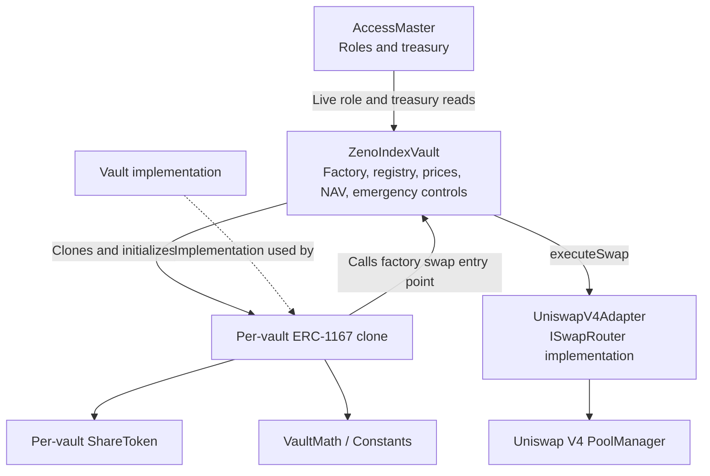

# ZenoIndex EVM

ZenoIndex is an EVM smart-contract system for creating and operating index-style vaults. Authorized creators launch vaults, investors deposit the configured stablecoin and receive vault shares, and vault managers manage allocations, swaps, rebalancing, and redemptions.

This repository contains the on-chain contracts and Foundry scripts. It is one part of the wider Zeno product: the mobile app and hosted Zeno backend are separate projects and integrate with these contracts through their own interfaces and API layers.

> [!IMPORTANT]
> **Mainnet deployment is complete for the contracts listed in this README. Do not rerun deployment or router-configuration scripts against this deployment.** The full live vault flow (deposit, swap/rebalance, and redemption) has not yet been confirmed end to end. Price updates currently use Uniswap V4 `slot0` spot prices, not a TWAP. Passing tests does not mean the system is audited or production-ready.

## Contents

- [Project overview](#project-overview)
- [Features](#features)
- [Architecture](#architecture)
- [Contract reference](#contract-reference)
- [Protocol lifecycle](#protocol-lifecycle)
- [Roles and permissions](#roles-and-permissions)
- [Assets, pricing, and swaps](#assets-pricing-and-swaps)
- [Redemptions and recovery](#redemptions-and-recovery)
- [Repository structure](#repository-structure)
- [Requirements](#requirements)
- [Clone and build](#clone-and-build)
- [Testing and development commands](#testing-and-development-commands)
- [Environment configuration](#environment-configuration)
- [Network details](#network-details)
- [Deployment guide](#deployment-guide)
- [Post-deployment verification](#post-deployment-verification)
- [Security and operational requirements](#security-and-operational-requirements)
- [Troubleshooting](#troubleshooting)
- [Related documentation](#related-documentation)

## Project overview

ZenoIndex provides on-chain infrastructure for index-style investment vaults:

1. An authorized account creates a vault with registered assets and target allocations.
2. The vault creates a share token. Investors deposit the configured stablecoin and receive shares based on the vault's calculated net asset value (NAV), subject to fee and share-supply rules.
3. A vault manager can buy assets and rebalance holdings through the configured swap router.
4. Investors can request redemption and claim proceeds after required swap legs are completed. Supported in-kind exit and recovery paths exist when a normal swap-based exit is not suitable or available.

Main components:

- **`ZenoIndexVault`**: factory, asset registry, price table, NAV valuation, swap entry point, emergency controls, and administrative relays.
- **`Vault`**: implementation used by each vault clone; manages shares, deposits, redemptions, allocations, and rebalancing.
- **`AccessMaster`**: shared source of truth for the super-admin, global operators, and treasury.
- **`UniswapV4Adapter`**: implements the swap-router interface and routes swaps through a Uniswap V4 `PoolManager`.
- **`VaultMath` and `Constants`**: financial calculations and protocol bounds.

## Features

- ERC-1167 minimal-proxy vault clones created by a factory.
- One six-decimal share token per vault.
- Configurable stablecoin for deposits and accounting. The contract variable is named `usdcToken`; the configured token can be USDC or USDG for a given factory instance.
- Admin-maintained token prices with stale-price and price-movement checks.
- Uniswap V4 exact-input, multi-hop swap adapter with explicitly registered pool keys and authorized callers.
- Deposit and redemption fees, share calculations, and share-cap handling.
- Target allocations and portfolio rebalancing.
- Swap-based redemption, in-kind exits, and timeout-based redemption settlement.
- Emergency, pause, and vault-lock controls.
- Write-off, reactivation, and written-off-token sweep flows.
- Foundry unit and regression tests.

## Architecture



## Contract reference

### `ZenoIndexVault.sol`

**What it does:** Acts as the vault factory and central registry. It creates vault clones, tracks registered assets and prices, calculates NAV, routes swaps, and provides administrative and emergency controls.

Key dependencies and execution path:

- `Clones.clone` creates an ERC-1167 clone of the vault implementation.
- `IVault(clone).init` initializes the newly created vault.
- `Constants.MAX_ASSETS` defines the asset-count bound.
- `ISwapRouter(router).swap` forwards approved swap requests to the configured router.

| Function | Purpose |
|---|---|
| `createVault` | Creates and initializes a vault clone. |
| `executeSwap` | Validates and forwards swaps from registered vaults. |
| `sumNav` | Calculates the portfolio's net asset value. |
| `setSwapRouter` | Configures the swap router. |
| `setPrice` / `setPriceWhole` | Updates asset prices. |
| `setVaultCreator` | Controls which accounts may create vaults. |
| `superAdmin` | Reads the super-admin from `AccessMaster`. |

Refer to the source for exact signatures, access modifiers, validation rules, and revert conditions.

### `Vault.sol`

**What it does:** Implements the lifecycle of an individual index vault, including deposits, share issuance, redemptions, claims, swaps, allocation management, and recovery flows.

Key dependencies and execution path:

- `VaultMath.computeSharesToMint` calculates shares for a deposit.
- `ShareToken.mint` issues vault shares.
- `ZenoIndexVault.sumNav` obtains the vault's NAV.
- `IZenoIndexVault.executeSwap` routes swaps through the factory.
- `ReentrancyGuard` protects applicable state-changing operations against reentrancy.

| Function | Purpose |
|---|---|
| `init` | Initializes the vault clone. |
| `genesisDeposit` | Handles the initial manager deposit. |
| `deposit` | Accepts a stablecoin deposit and issues shares. |
| `previewDeposit` | Quotes the shares expected from a deposit. |
| `requestRedeem` | Starts a redemption and burns shares. |
| `claim` | Claims stablecoin proceeds for a redemption. |
| `claimInKind` | Settles a redemption by transferring the underlying assets. |
| `executeRebalance` | Rebalances the portfolio toward its target allocations. |
| `swapUsdcToAsset` | Swaps the configured stablecoin for an asset. |
| `forceSettleRedeem` | Executes the supported timeout-based redemption settlement. |

Function names and availability should be checked against the current source before integrating with the contract.

### `AccessMaster.sol`

**What it does:** Centralizes privileged roles and treasury configuration used by the factory and vault system.

Key dependencies:

- OpenZeppelin `AccessControl` provides role-based access control.
- `setSuperAdmin` uses the contract's two-step super-admin transfer flow.
- `addOperator` grants the supported global operator role.
- `removeOperator` revokes the supported global operator role.
- `OPERATOR_ROLE` identifies the global operator permission.

| Function | Purpose |
|---|---|
| `superAdmin` | Reads the current super-admin. |
| `setSuperAdmin` | Proposes a super-admin transfer. |
| `acceptSuperAdmin` | Completes the proposed transfer. |
| `addOperator` | Adds an authorized global operator. |
| `removeOperator` | Removes a global operator. |
| `setTreasury` | Updates the treasury address. |

The source contract defines the exact role checks and validation requirements.

### `VaultMath.sol`

**What it does:** Contains shared calculations used by the vault system for share issuance, fees, redemption amounts, and allocation calculations.

Key dependencies:

- `Constants.BPS_DENOM` defines the basis-point denominator used in fee and percentage calculations.
- `Constants.PRICE_SCALE` defines the scale used by price-related calculations.

| Function | Purpose |
|---|---|
| `computeSharesToMint` | Calculates shares to mint for a deposit. |
| `computeDepositFee` | Calculates the deposit fee. |
| `computeRedeemAmounts` | Calculates redemption amounts. |
| `computeAllocationSlice` | Calculates the amount associated with an allocation. |

Check the library source for exact rounding behavior, bounds, and revert conditions.

### `UniswapV4Adapter.sol`

**What it does:** Implements the project's swap-router interface and executes swaps through the configured Uniswap V4 `PoolManager` using registered pool configurations.

Key dependencies:

- `IPoolManager` provides the Uniswap V4 pool-manager interface.
- `poolManager.unlock` starts the unlock/callback flow used by the adapter.
- `poolManager.swap` executes a swap against the selected pool.
- `TickMath` supports tick and price-limit calculations.

| Function | Purpose |
|---|---|
| `setAuthorizedCaller` | Authorizes or removes an account permitted to call the adapter. |
| `setPool` | Registers the pool configuration for a token pair. |
| `swap` | Executes a supported exact-input swap. |
| `unlockCallback` | Handles the PoolManager unlock callback. |

Pool registration alone does not establish that a pool is initialized or has usable liquidity. Verify the full pool key and live pool state before production use.

### Interfaces and mocks

The following files define interfaces or test helpers:

| File | Purpose |
|---|---|
| `IAccessMaster.sol` | Interface for shared role and treasury access. |
| `ISwapRouter.sol` | Interface for the swap-router implementation. |
| `IVault.sol` | Interface for vault operations. |
| `IZenoIndexVault.sol` | Interface for factory operations used by vaults. |
| `MockERC20.sol` | ERC-20 mock used in tests. |
| `MockSwapRouter.sol` | Swap-router mock used in tests. |
| `ERC20Minimal.sol` | Minimal ERC-20 implementation used by the project. |
| `ShareToken.sol` | ERC-20 share token associated with a vault. |

## Protocol lifecycle

### 1. Factory setup

The deployer configures the factory with the vault implementation, shared access contract, stablecoin, router, and fee escrow. Assets must be registered before they can be used in a vault.

### 2. Vault creation

An authorized creator calls `createVault` with the required vault configuration. The factory creates a clone and initializes it with the supplied parameters.

### 3. Genesis deposit

The manager makes the initial deposit required by the vault's initialization and share-supply rules. The exact amount and permitted timing depend on the current contract implementation.

### 4. Investor deposits

Investors deposit the configured stablecoin and receive shares based on the vault's NAV and fee rules. Deposits can be affected by price freshness, share caps, allocation constraints, and other validation checks.

### 5. Asset swaps and rebalancing

The vault requests swaps through the factory. The factory validates the request and forwards it to the configured adapter. The adapter uses registered Uniswap V4 pool configurations to execute supported swaps.

### 6. Redemption

An investor requests redemption. The vault applies the configured redemption rules and handles the corresponding share accounting. Stablecoin proceeds can be claimed after the required settlement steps, subject to available liquidity and the current contract state.

### 7. Recovery and emergency operations

The contracts include emergency and recovery paths, including supported in-kind redemption and write-off flows. These paths have their own conditions and permissions. They should be tested against the actual deployment before being relied upon during an incident.

## Roles and permissions

The exact permissions are defined by the current contract source. In general:

| Role | Responsibility |
|---|---|
| Super-admin | Performs privileged factory and system administration. |
| Global operator | Performs operations explicitly permitted by the contracts. |
| Vault manager | Manages a vault's supported portfolio and lifecycle operations. |
| Vault creator | Creates vaults when authorized by the factory. |
| Investor | Deposits stablecoin, holds shares, and uses supported redemption flows. |
| Treasury | Receives fees or other configured transfers where applicable. |

Do not assume a role has permission merely because its name suggests it. Check the relevant modifier and role check before calling privileged functions.

## Assets, pricing, and swaps

### Asset registration

Assets must be registered with the factory before they can be used in a vault. Each asset is represented by its registered asset ID. The factory's configured stablecoin occupies the stablecoin slot.

### Price updates

The factory maintains prices used for NAV and other price-dependent operations. Price updates are subject to the contract's validation rules, including configured movement and freshness constraints.

The current `UpdatePricesFromV4.s.sol` script reads Uniswap V4 `slot0` spot state for configured pools and submits prices to the factory. A spot price is not a time-weighted average price (TWAP), and the update script does not by itself provide manipulation-resistant oracle security.

### Swaps

The factory forwards authorized swap requests to the configured adapter. The adapter must have the correct PoolManager, caller authorization, and registered pool configuration.

Before a swap is attempted, verify:

- The exact token pair and pool key.
- The pool's initialization state.
- Hook configuration and any applicable hook restrictions.
- Current liquidity and expected price impact for the intended trade size.
- The minimum acceptable output.
- The adapter's authorization and the factory's router configuration.

A registered pool ID is not proof that a trade will succeed or receive a reasonable execution price.

## Redemptions and recovery

Redemption operations depend on the vault's available assets, required swap legs, share accounting, and configured settlement conditions.

The contract includes supported stablecoin-claim and in-kind recovery paths. Timeout-based settlement also has specific conditions. Review the current `Vault.sol` implementation and tests before integrating with these flows.

Do not treat the presence of a recovery function as a guarantee that every redemption can be completed under every market or emergency condition.

## Repository structure

The main source and script directories are organized as follows:

```text
.
├── src/
│   ├── adapters/
│   │   └── UniswapV4Adapter.sol
│   ├── interfaces/
│   │   ├── IAccessMaster.sol
│   │   ├── ISwapRouter.sol
│   │   ├── IVault.sol
│   │   └── IZenoIndexVault.sol
│   ├── libraries/
│   │   ├── Constants.sol
│   │   └── VaultMath.sol
│   ├── AccessMaster.sol
│   ├── ERC20Minimal.sol
│   ├── ShareToken.sol
│   ├── Vault.sol
│   └── ZenoIndexVault.sol
├── script/
│   ├── CheckRegisteredPools.s.sol
│   ├── ConfigureUniswapV4Adapter.s.sol
│   ├── Deploy.s.sol
│   ├── DeployAndConfigureUniswapV4Adapter.s.sol
│   ├── DeployUniswapV4Adapter.s.sol
│   └── UpdatePricesFromV4.s.sol
├── test/
│   └── ZenoIndexVault.t.sol
├── docs/
│   └── MAINNET_REVIEW.md
├── foundry.toml
└── README.md
```

The tree above highlights the principal contracts and scripts. Consult the repository for the complete list of files, tests, libraries, and dependencies.

## Requirements

Install the following tools before building or testing:

- Git
- Foundry (`forge`, `cast`, and `anvil`)
- An RPC endpoint for the network you intend to use
- A funded account only if you intend to broadcast transactions

Check the installed versions:

```bash
git --version
forge --version
cast --version
```

Never place a private key directly in a command that may be saved in shell history or shared in logs.

## Clone and build

Clone the repository and initialize submodules:

```bash
git clone https://github.com/CyreneAI/zenoindex-evm.git
cd zenoindex-evm
git submodule update --init --recursive
```

Build the contracts:

```bash
forge build
```

Check formatting:

```bash
forge fmt --check
```

## Testing and development commands

Run the full test suite:

```bash
forge test
```

Run tests with a summary:

```bash
forge test --summary
```

Run a specific test file:

```bash
forge test --match-path test/ZenoIndexVault.t.sol
```

Run tests matching a test name:

```bash
forge test --match-test testName
```

Generate coverage information:

```bash
forge coverage
```

The latest recorded test run for the deployment branch passed **259 tests, with 0 failures and 0 skipped tests**. Test results are tied to the tested code revision and do not establish that a live deployment has completed every end-to-end flow.

Before committing changes, run:

```bash
forge fmt --check
forge build
forge test --summary
git diff --check
bash script/check-readme-src-docs.sh
```

## Environment configuration

Use environment variables for RPC URLs, private keys, contract addresses, and other deployment settings. Keep secrets in a local `.env` file that is excluded from version control.

Example configuration:

```bash
# Network
RH_RPC_URL=https://rpc.mainnet.chain.robinhood.com

# Deployment account
PRIVATE_KEY=

# Existing deployed contracts
FACTORY_ADDRESS=0x494EcBd1d8df35fb39aD5973Ec0A1598ADF26eA9
ACCESS_MASTER=0xC3A8aB91f9CC66d789B33FD61674991aDEF3EdF2
VAULT_IMPLEMENTATION=0xb78A139e2f316527a53673b5F093ceE9566CD1A7
FEE_ESCROW=0x86867a40Da338dfaF75B8fB1f65bC3cc9Ca3b34F
ADAPTER_ADDRESS=0x1CD3F47e7137761e4c1066273893fbE778BB2Dd7
POOL_MANAGER=0x8366a39CC670B4001A1121B8F6A443A643e40951
```

This is an illustrative environment template. Individual scripts may require additional variables or use different variable names. Inspect the script before running it.

Do not commit `.env`, private keys, seed phrases, or other secrets. Never paste a private key into chat.

## Network details

### Robinhood Chain mainnet

| Setting | Value |
|---|---|
| Network | Robinhood Chain mainnet |
| Chain ID | `4663` |
| RPC URL | `https://rpc.mainnet.chain.robinhood.com` |
| Configured stablecoin | USDG |
| Stablecoin decimals | `6` |

Verify the chain ID before any transaction:

```bash
cast chain-id --rpc-url "$RH_RPC_URL"
```

The result should be `4663` for the deployment documented below.

Do not broadcast transactions if the chain ID, RPC endpoint, target addresses, or expected contract state does not match the intended environment.

## Deployment guide

> [!WARNING]
> The contracts described in the mainnet section below have already been deployed. The following commands are for understanding the deployment workflow or using an explicitly approved separate environment. **Do not rerun deployment scripts against mainnet simply to reproduce the existing deployment.**

### 1. Inspect the deployment script

Review the current script before executing it:

```bash
sed -n '1,240p' script/Deploy.s.sol
```

Confirm the expected environment variables, constructor parameters, registered assets, access roles, and network guards.

### 2. Simulate before broadcasting

Use a fork or other controlled test environment to validate the deployment and configuration sequence. Confirm the target addresses and resulting contract state before sending transactions to a live network.

### 3. Deploy only when explicitly required

The following is a general Foundry command pattern, not an instruction to deploy the already deployed mainnet system:

```bash
forge script script/Deploy.s.sol:Deploy \
  --rpc-url "$RH_RPC_URL" \
  --broadcast
```

Check the actual script contract name and required environment variables before use. Do not copy and execute a deployment command without reviewing its effects.

### 4. Configure an existing adapter

`ConfigureUniswapV4Adapter.s.sol` is intended to configure an adapter that already exists at the supplied address. It is not a reason to deploy a second adapter.

Before any configuration transaction, verify:

- The adapter address and PoolManager.
- The factory address and caller authorization.
- The exact pool keys, including fee, tick spacing, and hooks.
- Pool initialization and liquidity.
- Whether the target factory's router is already configured.

The current mainnet factory router is already configured. Do not rerun router-configuration transactions against it without an approved migration plan.

### 5. Update prices

`UpdatePricesFromV4.s.sol` reads configured Uniswap V4 `slot0` spot state and submits prices to the factory. It is not a TWAP oracle.

Before running the updater, verify the RPC, factory address, registered pool keys, token ordering, price direction, decimals, and configured safety bounds. Check the resulting on-chain prices and timestamps after execution.

### 6. Verify registered pools

`CheckRegisteredPools.s.sol` is available to inspect the registered pool configuration. Review its expected environment variables and checks before running it. A successful configuration check does not guarantee that the pools have enough liquidity for a specific trade.

## Post-deployment verification

Use read-only calls first. These examples query the deployed factory:

```bash
export RH_RPC_URL="https://rpc.mainnet.chain.robinhood.com"
export FACTORY_ADDRESS="0x494EcBd1d8df35fb39aD5973Ec0A1598ADF26eA9"

cast chain-id --rpc-url "$RH_RPC_URL"

cast call "$FACTORY_ADDRESS" "superAdmin()(address)" \
  --rpc-url "$RH_RPC_URL"

cast call "$FACTORY_ADDRESS" "router()(address)" \
  --rpc-url "$RH_RPC_URL"

cast call "$FACTORY_ADDRESS" "usdcToken()(address)" \
  --rpc-url "$RH_RPC_URL"

cast call "$FACTORY_ADDRESS" "feeEscrow()(address)" \
  --rpc-url "$RH_RPC_URL"
```

The expected values are documented in the mainnet deployment section. If a read fails, check the ABI, function signature, target address, and network before proceeding.

### Verify the adapter

Confirm the adapter's deployed address, PoolManager, registered pool keys, and authorized caller state using the current contract ABI. Do not infer authorization or pool initialization solely from a deployment transaction receipt.

### Verify prices

Check the registered price values and timestamps using the contract's actual getter signatures. Compare each price against an independently trusted source before relying on it for NAV-sensitive operations.

### Verify the complete vault lifecycle

Before accepting user funds, perform a controlled end-to-end test covering:

1. Vault creation.
2. Genesis deposit.
3. Investor deposit and share issuance.
4. Asset swap.
5. Rebalance.
6. Redemption request and settlement.
7. Stablecoin claim or supported in-kind recovery.

The deployment and unit-test results below do not mean this live sequence has already been completed successfully.

## Deployed Robinhood Chain Mainnet Contracts

The following contracts were deployed and configured on Robinhood Chain mainnet, chain ID `4663`.

### Core contract addresses

| Contract | Address |
|---|---|
| ZenoIndex Factory | `0x494EcBd1d8df35fb39aD5973Ec0A1598ADF26eA9` |
| `Vault` implementation | `0xb78A139e2f316527a53673b5F093ceE9566CD1A7` |
| `AccessMaster` | `0xC3A8aB91f9CC66d789B33FD61674991aDEF3EdF2` |
| `FeeEscrow` | `0x86867a40Da338dfaF75B8fB1f65bC3cc9Ca3b34F` |
| `UniswapV4Adapter` | `0x1CD3F47e7137761e4c1066273893fbE778BB2Dd7` |
| Configured stablecoin (USDG) | `0x5fc5360D0400a0Fd4f2af552ADD042D716F1d168` |
| Uniswap V4 `PoolManager` | `0x8366a39CC670B4001A1121B8F6A443A643e40951` |

The following factory reads were verified on-chain and matched the deployment configuration: `feeEscrow()`, `router()`, `superAdmin()`, and `usdcToken()`. Despite the variable name `usdcToken`, this factory is configured to use USDG.

#### Registered assets and latest recorded prices

The asset IDs below follow the registration order reported by the deployment logs. USDG is the stablecoin slot. Prices for the other assets are the values recorded by the last successful price-update batch, not guaranteed current market quotes.

| Asset ID | Symbol | Token address | Last recorded price (USDG per token) |
|---:|---|---|---:|
| `0` | USDG | `0x5fc5360D0400a0Fd4f2af552ADD042D716F1d168` | `1.000000` (stablecoin accounting) |
| `1` | NVDA | `0xd0601CE157Db5bdC3162BbaC2a2C8aF5320D9EEC` | `218.236705` |
| `2` | TSLA | `0x322F0929c4625eD5bAd873c95208D54E1c003b2d` | `363.906007` |
| `3` | META | `0xc0D6457C16Cc70d6790Dd43521C899C87ce02f35` | `723.526486` |
| `4` | MU | `0xfF080c8ce2E5feadaCa0Da81314Ae59D232d4afD` | `900.677103` |
| `5` | SPCX | `0x4a0E65A3EcceC6dBe60AE065F2e7bb85Fae35eEa` | `146.555189` |

**Price methodology and limitation:** The successful update batch calculated these prices from Uniswap V4 `slot0` spot state. They were not sourced from a TWAP or independently verified market-price feed. These are historical update values. The default maximum price age is one day, so a keeper or other trusted process must refresh prices before they become stale. Price-movement checks do not make spot prices manipulation-resistant.

#### Registered Uniswap V4 pool identifiers

These IDs identify the pool configurations registered in the adapter. Registration alone does not guarantee sufficient liquidity or acceptable execution for a given trade size.

| Pair | Registered pool ID |
|---|---|
| USDG / SPCX | `0x8567e70dbf639a618ba5eaf9402743452b93ca45c9bf8b97462407f07d7b7448` |
| USDG / TSLA | `0x8517f8071ae5b831b738052f12125e8e3d6c158b78728aa44ce3b25e5104d32e` |
| USDG / MU | `0x6fa3ee0048e78bf0a513eb0ab56f482944a767c21db990fcf555605e69f05659` |
| USDG / META | `0x5875d407a42965b0e768c8925cea290e06fa50603ef34fc99eb92a1050e6ae36` |
| USDG / NVDA | `0x6444a8e0b267406a15db74ca00c4a24bdfa81ed3180f5b6d0851f8ed6f4f29c5` |

#### Deployment and configuration transactions

| Operation | Transaction hash |
|---|---|
| Deploy `Vault` implementation | `0x761a4992c15794b787641f8bb8d86d445de9fc143d8541c44d245a31aabf0dd2` |
| Deploy `AccessMaster` | `0xf4a66295554d634616143bb9f972721708c9a6197f904ff5962cade767f9a1c5` |
| Deploy new factory | `0x75066cb735c1f3e72b57db039f613187af4b25d559f5dcc540559201470ff6e0` |
| Deploy `FeeEscrow` | `0xdd57c70d186cf031b8f2370c608a05b528bf9393a48fa58e2e35b38d058165d0` |
| Register `FeeEscrow` on factory | `0xa915c940d61765274273e5e7d3be049a0768050759431464c4073a65128ba243` |
| Authorize factory as adapter caller | `0x0a72e761d6db19816c78d53612ea88677e91f82ad5503cf39f233454ecabe561` |
| Configure factory router | `0x7458c74a34c2a6d55c8d6cef3c24c84adaa5bdd65d16157b3071397ab7f4b570` |
| Update SPCX price | `0xdafe8f4fcea8e96a140e6fec336a0ab6727c060f8b2159405ed285da39e1969b` |
| Update TSLA price | `0xcce752ab5923f46a12f29e8c31afb233399b932faf83ba717e9868f8d5f0d80f` |
| Update MU price | `0xd8b8b300cb262154fbaf389a9c303efdafff6c2cbc2762ffebc9fd5287691ae0` |
| Update META price | `0x663af87f065e748fe9492ecf6042f571a9a67e0667a172dae9378d9e0aeaf791` |
| Update NVDA price | `0x218e0f3bc5e2a5792e2028bd55d38d7b5ed8b8d91c7c857bd92fbaa2c55efb6e` |

Adapter configuration transactions were confirmed successful. The five asset price-update transactions also completed successfully.

#### Verification status

- Mainnet deployment of the core contracts completed.
- The adapter was configured, the factory was authorized as an adapter caller, and the factory router was set.
- Factory reads for `feeEscrow()`, `router()`, `superAdmin()`, and `usdcToken()` were checked on-chain.
- The latest reported Foundry test run passed **259 tests, with 0 failures and 0 skipped tests**.
- The complete live vault flow has **not yet been confirmed end to end**. Genesis deposit, investor deposit, swap, rebalance, redemption, and recovery paths still need a controlled end-to-end test before accepting user funds.
- The price updater currently uses V4 spot state (`slot0`), not a TWAP. Production use needs a documented price source, refresh process, monitoring, and explicit review of price-manipulation risk.
- The current super-admin is the deployer EOA listed above. The internal review recommends moving privileged control to a secure multisig before production use.

#### Source control record

- Repository: [`CyreneAI/zenoindex-evm`](https://github.com/CyreneAI/zenoindex-evm)
- Branch: `feat/zenoindex/phase-1-hardening`
- Commit: [`e755a31`](https://github.com/CyreneAI/zenoindex-evm/commit/e755a31) — `Harden price updates and add V4 deployment scripts`

**Do not rerun the deployment or router-configuration scripts against this mainnet deployment merely to reproduce the setup.** They can deploy new contracts or fail because the factory router is already configured. Use the addresses documented above for integration and independently verify live state before any further mainnet transaction.

## Security and operational requirements

Read [`docs/MAINNET_REVIEW.md`](docs/MAINNET_REVIEW.md) before deploying. It records the internal review, bugs fixed, regression tests, accepted risks, and operational recommendations.

Important considerations:

- **Internal review is not a third-party audit.** Do not claim a formal external audit or formal verification unless one has actually been completed.
- **Admin custody:** a compromised privileged key can perform powerful administrative actions. The review recommends a multisig for production super-admin custody.
- **Price-table trust:** prices are admin-maintained rather than supplied by an on-chain market oracle. Incorrect or stale prices affect NAV-sensitive operations.
- **Pool/liquidity risk:** configuration does not guarantee liquidity or acceptable execution. Verify each route and intended trade size.
- **Token compatibility:** fee-on-transfer and rebasing tokens are unsupported by the current design.
- **Emergency behavior:** pause and emergency restrictions differ by function. Check the code and tests rather than assuming all exits are available in every state.
- **Operational monitoring:** stale prices, missing pools, incorrect permissions, and insufficient liquidity can block expected flows.
- **Coverage is not proof of security:** tests and coverage measurements are useful evidence but are not a substitute for review, operational controls, or an external audit.

## Troubleshooting

| Symptom | Things to check |
|---|---|
| `forge` is not recognized | Install Foundry and open a new terminal; verify `forge --version`. |
| Build cannot resolve imports | Run `git submodule update --init --recursive`; verify `lib/` and remappings. |
| RPC connection or chain-ID error | Check `RH_RPC_URL`, RPC availability, and the chain ID reported by the endpoint. |
| Missing or stale price | Verify every non-stablecoin asset has a price and its timestamp is within `maxPriceAge`. |
| `createVault` reverts | Verify router configuration, creator permission, registered assets, prices, and allocation inputs. |
| Adapter rejects a swap | Check caller authorization, factory clone registration, path, pool registration, PoolManager, and callback access. |
| Swap fails for a registered pair | Verify the exact V4 pool key, initialized state, hook allowlisting, liquidity, input amount, and minimum output. |
| Configuration script says adapter is not deployed | The standalone script requires an adapter already deployed on the same target chain. A separate fork simulation does not persist deployment state. |
| Router is already configured | The configuration scripts expect an unset router. Read live state and follow an approved migration procedure; do not blindly rerun the script. |
| Price update is rejected | Check zero-price validation, maximum allowed price change, and configured safety bounds. |

When a failure is not explained by the repository or trace, record the exact command, chain ID, transaction hash (if any), and revert data. Do not guess at production configuration.

## Related documentation

- [`docs/MAINNET_REVIEW.md`](docs/MAINNET_REVIEW.md) — internal security review, bugs fixed, accepted risks, coverage, and deployment checklist.
- [`script/Deploy.s.sol`](script/Deploy.s.sol) — core contract deployment and optional asset registration.
- [`script/DeployUniswapV4Adapter.s.sol`](script/DeployUniswapV4Adapter.s.sol) — adapter deployment script.
- [`script/ConfigureUniswapV4Adapter.s.sol`](script/ConfigureUniswapV4Adapter.s.sol) — configuration for an existing adapter.
- [`script/DeployAndConfigureUniswapV4Adapter.s.sol`](script/DeployAndConfigureUniswapV4Adapter.s.sol) — combined adapter deployment/configuration script.
- [Foundry Book](https://book.getfoundry.sh/) — Foundry tooling documentation.

## Contributing

Keep changes scoped to the task and update tests and documentation when behavior or deployment requirements change. Before opening a pull request, run:

```bash
forge fmt --check
forge build
forge test --summary
git diff --check
bash script/check-readme-src-docs.sh
```

For deployment changes, verify the documented commands and environment variables against the checked-in scripts. Never commit `.env`, private keys, seed phrases, or other secrets.
